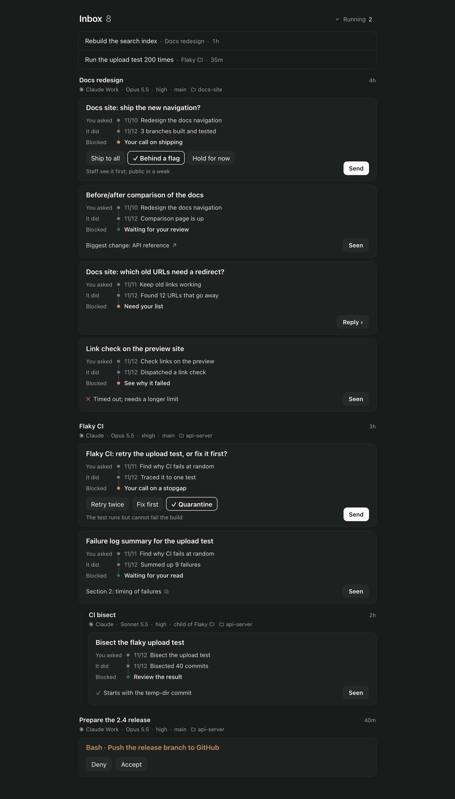
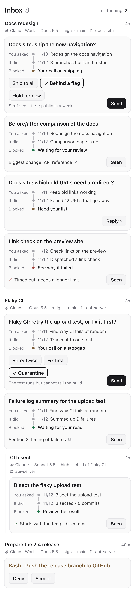
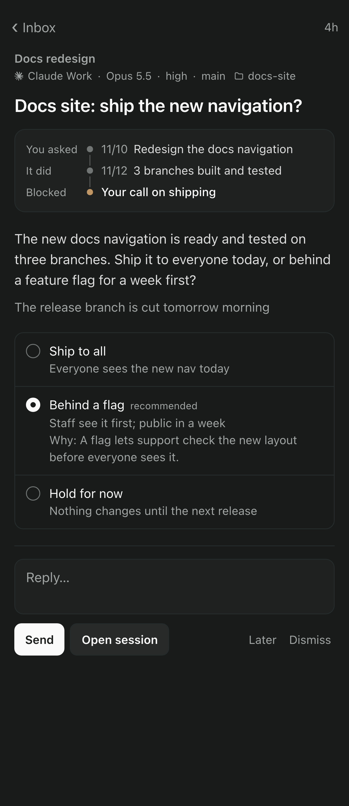

# Agent inbox

A [Paseo](https://paseo.sh) plugin that gives you one inbox for everything your coding agents need from you: decisions only you can make, results to look at, permission requests, and dispatched work that came back. Agents file one card per thing through three tools; you answer on the card, and the answer goes into the agent's session as your message. A small CLI lets agents outside Paseo file cards into the same inbox.

| Overview (desktop) | Overview (phone, light) | One card (phone) |
|---|---|---|
|  |  |  |

## Features

- One card per thing that needs you: a question, a result, returned work, a permission request or a failed turn.
- A per-card recall in three steps: **You asked** → **It did** → **Blocked**.
- Answer on the card: tap an option (the agent's recommendation is preselected), add a reply, **Send**. Permission requests are answered with the same buttons Paseo shows.
- **Seen** closes results and returned work; **Dismiss** tells the agent not to wait for an answer; **Later** moves a card to the end.
- Cards grouped by session, with child sessions nested under the session that started them.
- A **Running** list of dispatched work; when a tracked `paseo run` child finishes, its result is filed automatically.
- Works on desktop and phone, in Paseo's light and dark themes.

## Requirements

- Paseo 0.15.3 or later, with plugins enabled on the daemon (Settings → Plugins).
- Node 25 or later on the daemon host (the `engines` field; tested on 25.9). The store uses the built-in `node:sqlite`, and the CLI runs its TypeScript source directly. Older Node versions are untested.
- npm, to install the plugin's dependencies.

## Install

```sh
git clone <repository url> paseo-agent-inbox
cd paseo-agent-inbox/paseo-plugin
npm ci
paseo plugin install "$PWD"
paseo plugin ls            # agent-queue should be running
```

If it shows as disabled, run `paseo plugin enable agent-queue`. Open sessions pick up the tools when Paseo reopens them, before their next prompt. The **Inbox** row appears in the sidebar.

Paseo can also install from Git: `paseo plugin install github:<owner>/paseo-agent-inbox:paseo-plugin`. The manifest's `build` step runs `npm ci` in the plugin directory.

## How agents use it

Every interactive Paseo session gets three tools from a plugin-owned MCP server named `agent-queue`:

| Tool | Does |
|---|---|
| `queue_add` | Files one card: `topic`, `timeline`, and exactly one of `ask`, `result`, `receipt`. Filing the same line again updates that card; `replaces` swaps one. |
| `queue_track` | Registers dispatched work, so it shows under Running. |
| `queue_resolve` | Closes the agent's own cards once they are handled (`cards: [ids]` or `all: true`). |

The tool descriptions carry the rules in short, which is enough to get started. For better cards, install the agent guide in [`skill/SKILL.md`](skill/SKILL.md): when to file, one card per thing, plain wording, resolving, and what the inbox's messages mean. For Claude Code:

```sh
ln -s "$PWD/skill" ~/.claude/skills/agent-inbox   # from the repository root
```

Other agents can be pointed at the same file, for example from `AGENTS.md`.

## CLI

`bin/agent-queue` files and manages cards from any shell, for agent hosts other than Paseo and for scripts. Cards from other hosts use the host id `dsh`; they show in the inbox, but are answered in their own session.

```sh
export AGENT_QUEUE_SESSION=dsh:my-session-1      # or --host dsh --session my-session-1
bin/agent-queue add <<'EOF'
{"topic": "Docs redesign",
 "timeline": {"asked": {"date": "11/10", "text": "Redesign the docs nav"},
              "did": {"date": "11/12", "text": "Built and tested 3 branches"},
              "stuck": {"text": "Your call on shipping"}},
 "ask": {"short": "Docs site: ship the new navigation?",
         "question": "Ship the new navigation to everyone, or behind a flag first?",
         "options": [{"label": "Ship to all"}, {"label": "Behind a flag"}], "recommended": 1}}
EOF
bin/agent-queue list                      # open cards; --json for everything, --done for closed ones
bin/agent-queue resolve --card c-1a2b3c4d5e
bin/agent-queue track --title "Rebuild the search index"
bin/agent-queue --help                    # every command
```

## Settings

All are environment variables. The plugin reads them from the environment the Paseo daemon starts with.

| Variable | Default | Effect |
|---|---|---|
| `AGENT_QUEUE_DB` | `~/.local/share/agent-queue/queue.db` | Database file, for the plugin and the CLI (the CLI also takes `--db`). |
| `AGENT_INBOX_LANG` | English | `zh` sends the messages that go into sessions (Send, Dismiss) in Chinese. |
| `AGENT_INBOX_EXTERNAL_URL` | unset | The http(s) page **Open session** opens for cards from another host; `{session}` stands for the session id. Without it, those cards have no Open session button. |
| `AGENT_QUEUE_SESSION` | set by the plugin | `<host>:<session id>`. The plugin sets it to `paseo:<agent id>` in every session; set it yourself for other hosts. |

## Where data lives

One SQLite file (WAL mode), `~/.local/share/agent-queue/queue.db` unless `AGENT_QUEUE_DB` says otherwise. It holds the cards and the dispatch tracks, open and closed. The plugin and the CLI share it; each write runs in its own transaction, so several processes can use it at once. Schema migrations run when the file is opened and only add columns. Nothing leaves the machine: the plugin's MCP server listens on 127.0.0.1 with a per-session token.

## Development

```sh
cd paseo-plugin && npm ci && cd ..   # also provides tsc and links core into the plugin
npm test                             # node:test over core, plugin server and shared modules
npm run typecheck
```

The UI harness renders the real inbox component with react-native-web from a seeded database and takes headless Chrome screenshots (`shoot.mjs` expects Chrome at its macOS path):

```sh
cd ui-harness && npm ci
node seed-demo.mjs /tmp/inbox-demo.db              # --with-legacy adds an older multi-item card
AGENT_QUEUE_DB=/tmp/inbox-demo.db AQ_NOW=2026-11-12T19:00:00Z AQ_HOME=/home/demo node build.mjs
node shoot.mjs /tmp/overview.png 390 3 1 "compact=1"   # <out> <width> <scale> <mobile> [query]
```

Query parameters: `compact=1`, `theme=light`, `card=<id>` (detail), `running=1`, `external=1`; see `ui-harness/main.tsx`. The design notes are in [`docs/design.md`](docs/design.md).

## Limitations

- The inbox shows only in Paseo. Other hosts file through the CLI, cannot be answered from the inbox, and get an Open session button only with `AGENT_INBOX_EXTERNAL_URL`.
- Work Paseo cannot see, such as a coding agent's in-process subagents, is not reported automatically: the agent files the receipt itself.
- No notifications beyond the sidebar count; the screen polls every 5 seconds.
- Card fields have width limits sized for a phone screen; `topic` is at most 15 characters.
- Permission requests whose questions take several answers are answered in the session.
- Messages into sessions come in English or Chinese only.
- One database per daemon host; nothing syncs between machines.

## License

[MIT](LICENSE)
